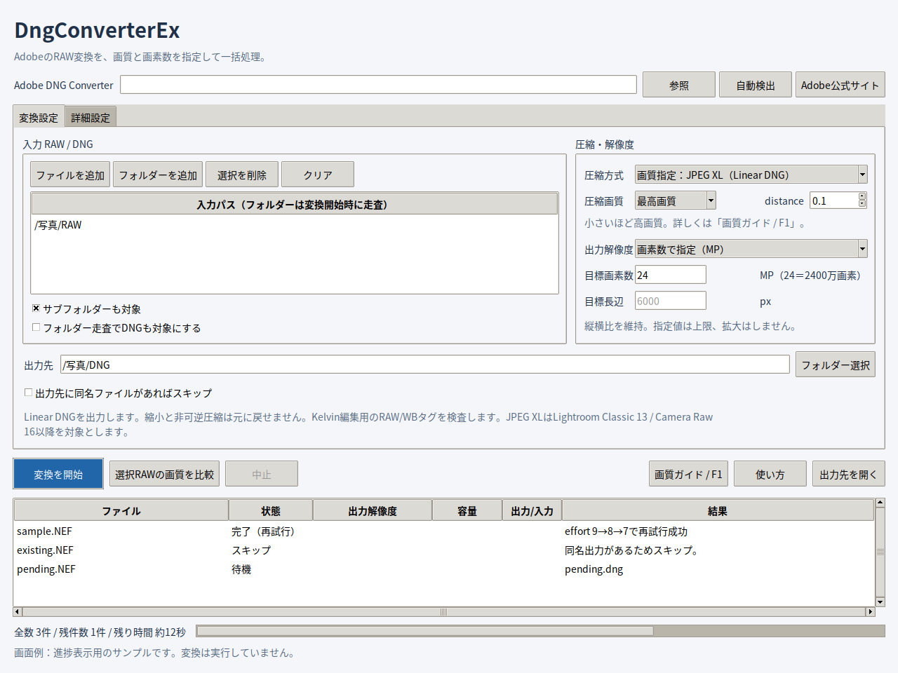

# DngConverterEx

RAWを圧縮DNGへ一括変換するPython GUIです。変換にはインストール済みの **Adobe DNG Converter** を使います。Lightroomへの取り込みは手動です。



*画面例はv1.3.0です。現在版は「変換設定」に並列実行数・元ファイル削除、「出力サイズ」タブにサイズ制限を追加しています。*

## 起動

Python 3.10以降・Tkinterと、[Adobe DNG Converter](https://helpx.adobe.com/camera-raw/desktop/dng-and-file-formats/adobe-dng-converter.html)を用意してください。JPEG XLにはAdobe DNG Converter 16以降を使います。変換の対象OSはWindows / macOSです。

最初に、このフォルダーで依存パッケージをインストールします。

| OS | インストール | 起動 |
|---|---|---|
| Windows | `py -3 -m pip install .` | `launch_windows.cmd` をダブルクリック |
| macOS | `python3 -m pip install .` | `bash launch_macos.command` |

優先度・CPU使用率の制御にはpsutilを使用します。WindowsのEXEを作る場合は `build_windows_exe.cmd` を実行してください。

## 使い方

1. RAWファイルまたはフォルダーを追加。
2. 出力先・圧縮方式・画質・出力解像度を選択。
3. 必要なら、変換設定の出力先欄の下にある「出力先に同名ファイルがあればスキップ」をON。
4. 「並列実行数」を指定して「変換を開始」。出力DNGをLightroomへ手動で取り込み。

| 設定・表示 | 内容 |
|---|---|
| JPEG XL distance | 小さいほど高画質。明暗の編集耐性を優先する比較開始値は0.1〜0.2 |
| JPEG XL effort | 大きいほど時間をかけて圧縮。初期値は7 |
| 出力解像度 | 原寸・MP・長辺。縦横比を維持し、指定値を上限として縮小 |
| 既存出力のスキップ | ONで既存ファイルを保持して次へ進む。初期状態はOFF |
| スキップOFF時の同名処理 | 詳細設定で連番付加／上書きを選択。初期値は連番付加 |
| 並列実行数 | 変換設定で1〜32を指定。初期値1は順次処理。指定数を上限として複数のAdobeプロセスを実行 |
| 速度優先に設定 | 変換設定のボタン。effort 7・通常優先度・CPU100%・並列2へ変更。distance・解像度・出力方式は維持 |
| 成功した元ファイルの削除 | 変換設定のチェックで有効化。初期OFF。DNGの検査・保存が成功した元ファイルだけを削除 |
| 最大ファイルサイズ | 「出力サイズ」タブでMB指定。初期値0は制限なし。1 MB＝1,000,000バイト |
| サイズ超過時 | 「失敗として次へ進む」または「distanceを上げて再変換」を選択 |
| distance増分・上限 | 自動調整用。初期値は増分0.1・上限6。画質指定JPEG XLでのみ使用可能 |
| 全数・残件数 | プログレスバーの横に表示。スキップ・失敗も処理済みとして数える |
| 残り時間 | 終了した変換の平均時間・並列数・実行中の経過時間から推定。最初は「計算中」。再試行時間を含め、予定スキップを除外 |
| プロセス優先度 | 詳細設定で通常／低め／最低を選択 |
| CPU上限（目安） | 詳細設定で1〜100%。PC全論理CPUに対する並列処理全体（子プロセスを含む）の平均使用率。100%は制限なし |

CPU制御は一時停止・再開で平均使用率を調整します。全変換のCPU時間を合算して上限を共有し、読み書きなどでCPUを使わない変換の余力も利用できます。瞬間的には上限を超える場合があります。画質・解像度は変えませんが、変換時間は長くなります。CPU制限による待機時間もファイルの制限時間に含まれます。

並列数を増やすとメモリ使用量も増えます。中止すると全実行中の変換を停止し、待機中の入力は未処理のまま残します。再試行は同じ枠で行い、指定並列数を超えません。制限時間は各ファイルの変換開始から数え、順番待ちは含みません。

ファイルを直接追加する場合は拡張子を制限しません。TIFFや独自拡張子もAdobeへ渡し、変換結果で成否を判断します。フォルダー走査では既知のRAW拡張子とTIFFを対象にします。

設定は次回起動時にも復元します。元ファイル削除は、バッチの全変換終了後に実行します。同じ入力から複数出力する場合は全出力の成功が条件です。スキップ・失敗・中止・未処理の入力は保持します。変換後に元ファイルが変わった場合や、出力DNGを確認できない場合も保持します。削除の成否は結果一覧とJSONLレポートへ記録します。

## 変換が遅い場合

まず「速度優先に設定」を選び、同じ入力を別の出力先で比較してください。effort 9は処理が重く、速度を優先する比較開始値は7です。distanceの目標は維持しますが、容量や復号画素の完全一致は保証しません。並列2は試験の開始値で、最速の保証ではありません。1・2・4で実測すると、CPU・メモリ・保存先に合う並列数を選べます。SDカードや遅い外付けドライブを使っている場合は、入力と出力を内蔵SSDで比較してください。

| 記録・表示 | 意味 |
|---|---|
| resultのelapsed_seconds | そのファイルの開始から終了まで。並列処理では他のファイルと重なる |
| cpu_throttle_seconds | アプリのCPU制限による一時停止待機時間。各試行とファイル合計を記録 |
| summaryのseconds_per_success / GUIの実績 | バッチの実時間÷成功出力数。並列処理全体の平均秒/出力。走査前の時間を除き、スキップ判定・失敗・削除などの処理時間は含む |

GPU・WinML等の警告だけでは、変換時間の原因は判別できません。速度優先設定の実Adobeでの改善倍率は未測定です。

## 出力ファイルサイズの制限

最大サイズはプレビュー・メタデータ・埋め込み元RAWなどを含む、完成したDNG全体で判定します。
上限ちょうどは成功、上限を超えた出力は一時フォルダー内で破棄します。
「失敗として次へ進む」はエラーとして記録し、バッチを継続します。元RAWと既存の出力は保持します。
既存ファイルのスキップをONにしている場合は既存出力を再変換・サイズ検査せず、従来どおりスキップします。

「distanceを上げて再変換」は、指定した開始distanceで変換し、サイズ超過時だけ指定増分を加えます。
たとえば開始0.2・増分0.1なら0.2→0.3→0.4…と、毎回元RAWから変換し直します。
上限を跨ぐ増分では最後に上限値を1回試します。上限でも収まらなければ失敗して次のファイルへ進みます。
増分は0.000001〜6、上限は開始distance以上かつ6以下です。全試行で中止・制限時間を共有します。
容量が毎回小さくなることや、必ず指定サイズに収まることは保証しません。

サイズ調整ではeffort・解像度・プレビューを変更しませんが、distanceの増加は画質を下げる操作です。
階調や編集耐性を優先する場合はdistance上限を小さくするか、「失敗として次へ進む」を選んでください。
従来のassert対策をONにしている場合は、該当エラー時にeffortも段階的に下がります。
ロスレスJPEGへの代替出力にも同じサイズ上限を適用し、超過時は画質調整せず失敗します。
レポートには要求設定・最終採用設定・各試行の設定と出力バイト数を記録します。

## 画質とLightroom

「**画質ガイド / F1**」で、distance・effort、ハイライト／シャドウの編集耐性、Adobeの設定、Lightroomでの確認方法を読めます。

画質指定JPEG XLは**非可逆のLinear DNG**です。元RAWと同じ情報量を保持するものではありません。原寸のRAW情報を優先する場合は、ロスレスJPEG圧縮DNGを選んでください。

カラーRAWではKelvin編集に必要なWB・カラーメタデータを検査します。JPEG XLはLightroom Classic 13 / Camera Raw 16以降を対象にします。実Adobeでの機種別変換・画質・Lightroom操作は実機未検証です。

## JPEG XLのassert対策

対象は、Adobeの異常終了と、同じ行の `enc_ans.cc`・`JXL_DASSERT`・`n <= 255` が一致した場合です。

| 詳細設定 | 動作 |
|---|---|
| 自動再試行（初期ON） | effort 9→8→7、または8→7。成功した時点で終了。distance・解像度は維持 |
| ロスレスJPEGへの代替出力（初期OFF） | 原寸時だけ、対象assertが残る場合に元RAWから変換方式を変更 |

各試行は別プロセス・一時フォルダーを使い、中止と制限時間は全試行で共有します。再試行しても全数・残件数は増えません。Adobe内蔵版で同じ不具合か、回避できるかは未確認です。

## CLI・テスト

```bash
python app.py convert "RAW" --output "DNG" --mp 24 --distance 0.2 --collision skip --jobs 2 --priority low --cpu-limit 50
python -m raw_to_dng convert "RAW" --output "DNG" --max-file-mb 20 --oversize-action fail
python -m raw_to_dng convert "RAW" --output "DNG" --distance 0.2 --max-file-mb 20 --oversize-action increase-distance --distance-step 0.1 --max-distance 0.8
python -m unittest discover -s tests -v
```

成功した元ファイルも削除する場合は `--delete-source` を指定します。
速度優先設定は `--speed` です。指定時はeffort・優先度・CPU上限・並列数を上記の値へ変更します。

対応機種はAdobe DNG Converterに従います。テストの圧縮DNGは合成データで、画像互換性の証明には使用できません。

[MIT License](LICENSE.txt)。Adobe製品とpsutilはそれぞれのライセンスに従います。

